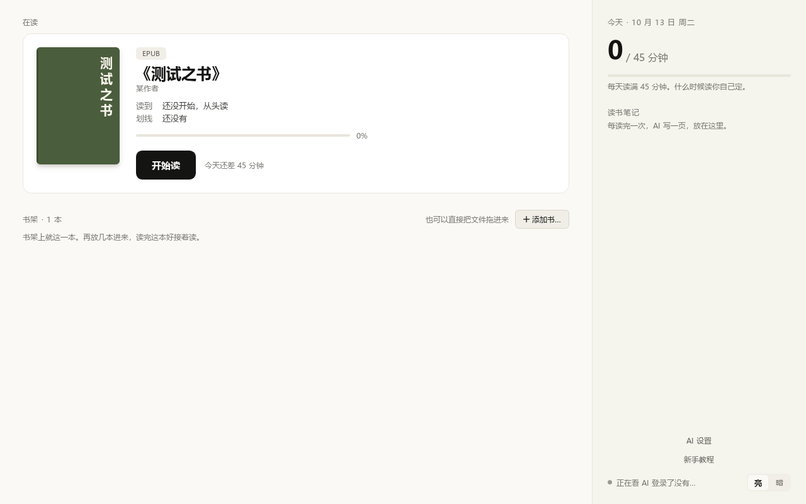
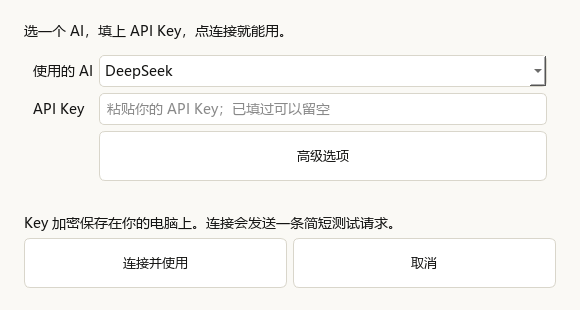
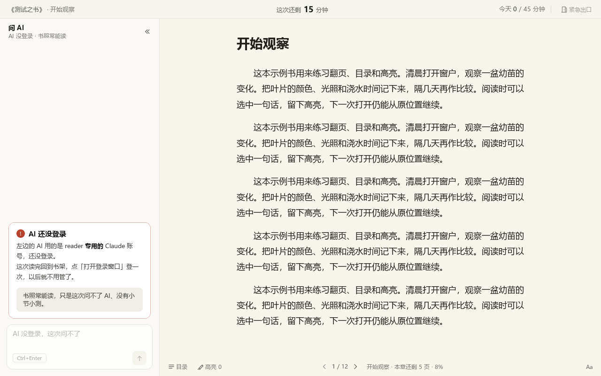
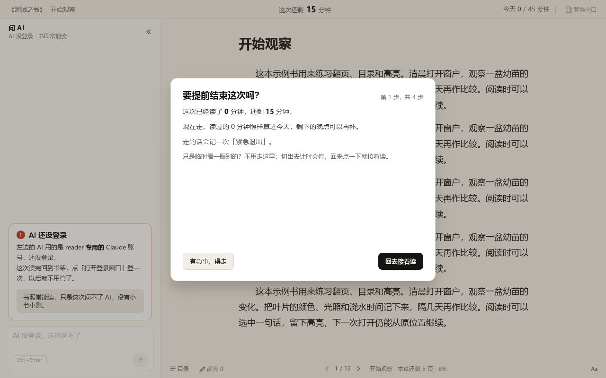

# 第一次使用 reader

本手册对应 v1.0.1。书架右侧的“新手教程”入口可打开随 EXE 提供的离线手册。

reader 是 Windows 桌面阅读器，书页在右边，AI 问答在左边。普通阅读不需要先配置 AI；PDF 和 EPUB 都可以加入书架。

书架右侧的 **新手教程** 可以打开离线图文手册。Release 附件中的 `reader-guide.html` 也可以直接双击查看。

## 1. 下载并打开

请下载 v1.0.1 或更新版本的 `reader-windows-x64.exe`。

打开 [reader 的 GitHub Releases](https://github.com/Huaiyuan-Jiang/reader/releases)，在最新版本的 Assets 中下载 `reader-windows-x64.exe`，双击运行。它适用于 Windows 10/11 x64，不需要安装 Python。第一次打开要解压运行组件，可能比之后慢一些。

## 2. 把书放进书架

在书架点 **添加书…**，选择 PDF 或 EPUB；也可以把书文件直接拖到窗口里。导入完成后，书会出现在书架上；点 **开始读** 会先打开时长确认框，不会立刻开始。

如果书架有多本书，点某本书旁边的 **设为在读**，再点主卡片上的 **开始读**。导入时程序记录文件位置，不会把文件移到别处；之后如果移动或重命名了书文件，见[找不到书](#找不到书或移动了书文件)。

## 3. 先不配置 AI，读一次试试

你可以先跳过 AI 设置。在书架选一本书并点 **开始读**。确认框会显示书名、从上次位置继续或从头开始、预计时长，以及开始后会看到的功能。选一个预设时长，或在 **自己填** 里输入分钟数，再点写有具体时长的 **开始读 N 分钟**。

默认时长会补足今天距离 45 分钟目标的差额；如果今天已经读满，默认 15 分钟。自定义时长支持 5 至 180 分钟。超过 90 分钟时，框内会提醒这是一次很长的阅读；开始后要读满所选时长，提前离开需走紧急出口。

没登录 AI 也能正常读书。左栏会说明 AI 尚未登录；这次没有 AI 问答和小节小测，也不会生成 AI 笔记。阅读计时、翻页、划线和阅读记录仍可使用。

开始后，按提示在右侧读书。按 **→**、**空格** 或点底栏的下一页箭头翻到下一页；按 **←** 或点上一页箭头返回。PDF 也可以滚动页面。

计时全屏阅读期间，Alt+Tab 和 Alt+Shift+Tab 会暂时禁用。读满所选时长或结束阅读后会恢复。需要提前结束时，请用右上角的 **紧急出口**。连续 5 分钟没有操作时计时也会暂停。开发模式不禁用快捷键。

## 4. 配置 AI

结束本次阅读并回到书架后，点右侧 **AI 设置**。选择你要使用的服务。

- 使用 DeepSeek、MiMo、GPT / OpenAI、Claude API 或其他 HTTP 接口时，填入该服务的 API Key，然后点 **连接并使用**。程序会保存配置并发送一条简短请求；成功后设置窗口关闭，失败时会显示提示。请求可能按服务商规则计费。
- 已经安装本机 Claude Code 时，选择 **Claude Code**，点 **连接并使用**。如果还没登录，程序会打开登录窗口；登录后回到设置，再点一次 **连接并使用**。
- 使用本地 Harness 时，选择 **本地 Harness**，点 **复制接入提示词**，把提示词交给你常用的本地 AI 工具完成接入。详细步骤见[本地 Harness 说明](HARNESS.md)。

配置成功后，下一次阅读可以使用左侧问答、小节小测和 AI 笔记。云端服务会收到你发送的问题和相关书中文字；配置细节及数据说明见[模型接入与修改](AI_CONFIGURATION.md)。本教程没有使用真实模型验证账户权限或服务可用性。

## 5. 阅读、引用和划线

在书页上拖选一段文字，选区旁会出现两个按钮。

- 点 **问 AI**，这段原文会带到左侧输入框。可直接发送以请求解释，也可以补充问题；点发送按钮或按 **Ctrl+Enter** 发送。**Enter** 用于换行。
- 点 **高亮**，这段文字会标黄并保存在这本书的记录里。再次选中已有高亮，可点 **取消高亮**。

底栏的 **目录** 可跳到目录中的章节；**高亮 N** 可查看这本书保存的高亮；**Aa** 可以调整字号和单页、双页或滚动布局。EPUB 和 PDF 可用的排版选项略有不同。

有 AI 时，读到小节末尾可能会在左侧出现一道小测。点一个选项，再点 **就选 A/B/C/D** 确认；第一次答错还可以再试一次。也可以点 **跳过这题**。这题不计对错，这一节不会再次出题，继续读即可。答完后点 **接着读下一节 ›** 可继续。没有 AI 登录时不会出小测，也不会阻止翻页。

## 6. 正常结束或紧急退出

读够开始时选的时长后，界面会显示 **再读一会儿** 和 **结束，看读书笔记**。想继续就点前者；继续阅读的时间也会计入当天记录。想结束就点后者。

提前结束请点顶栏右侧 **紧急出口**，按界面完成四步确认。说明要提前结束、选择一个原因、等待后再次确认、查看最后确认信息并结束。紧急退出会记入阅读记录；已经读过的时间照算。中途改变主意，按 **Esc** 或选择回去继续读的按钮即可取消。计时阅读期间 Alt+Tab 无法切到别的程序；读满后会恢复。

正常结束后会打开本次记录和笔记页。若 AI 已配置，笔记可能先显示正在生成，完成后出现在纸面上；若没有配置或生成失败，阅读记录仍保留，页面会说明笔记状态。点 **回书架** 返回书架。以后可从书架右侧的笔记列表重新打开旧笔记和对应记录。

## 找不到书或移动了书文件

书文件被移动、改名或删除后，书架会标记 **文件找不到了**，并禁用 **开始读**。在这本书的卡片上点 **重新找…**，在文件选择窗口中选中它现在的位置。重新关联成功后即可继续阅读；如果文件已经删除，请先从备份恢复文件，再重新关联。

## 常见卡点

- **书架上没有书。**点 **添加书…** 选择 PDF/EPUB，或把文件拖到书架窗口。
- **点了开始读，但还没进书页。**这是时长确认框。选时长后再点 **开始读 N 分钟**；点 **取消** 或按 **Esc** 会返回书架。
- **左栏说 AI 还没登录。**不影响阅读；要使用问答、小测和 AI 笔记，先结束当前阅读，再从书架点 **AI 设置** 完成连接。
- **扫描版 PDF 没有文字可选。**扫描版需要先完成本机文字识别；书架会显示识别状态。没有可识别文字时不能划线或让 AI 阅读正文。
- **Alt+Tab 没有反应。**计时全屏阅读期间会暂时禁用；读满或结束后自动恢复。确实需要提前结束时，请用 **紧急出口**。
- **紧急出口点不动。**部分步骤需要先选择原因或等提示中的时间结束；也可以按 **Esc** 回去继续读。
- **想换 AI 设置或亮暗主题。**先结束阅读回到书架。阅读期间书架设置入口不可用。
- **AI 连接失败。**核对选中的服务和它对应的 API Key，再检查网络。在 **高级选项** 中核对模型 ID 和接口地址。错误提示出现后再重试；只登录服务商网页不等于已配置 API Key。
- **下载后打不开。**确认下载的是 `reader-windows-x64.exe`，电脑运行 Windows 10 或 11 的 x64 版本。如果安全软件提示拦截，先核对下载来自本项目的 Release 和附件校验值，再处理提示，不要直接关闭安全软件。

## 数据与升级

软件把阅读位置、高亮、笔记和设置保存在你的电脑上。替换为新版 EXE 后通常可以继续使用这些数据；更新前退出旧版，保留书文件原位置，再打开新版。

如果书架提示文件损坏，程序会先保留原文件备份，再恢复能读取的条目。不要删除提示中提到的备份文件。先重新添加缺少的书，必要时请熟悉电脑的人协助恢复。
